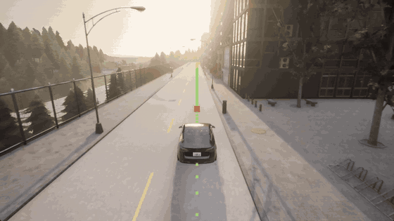
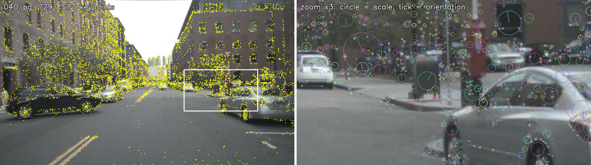
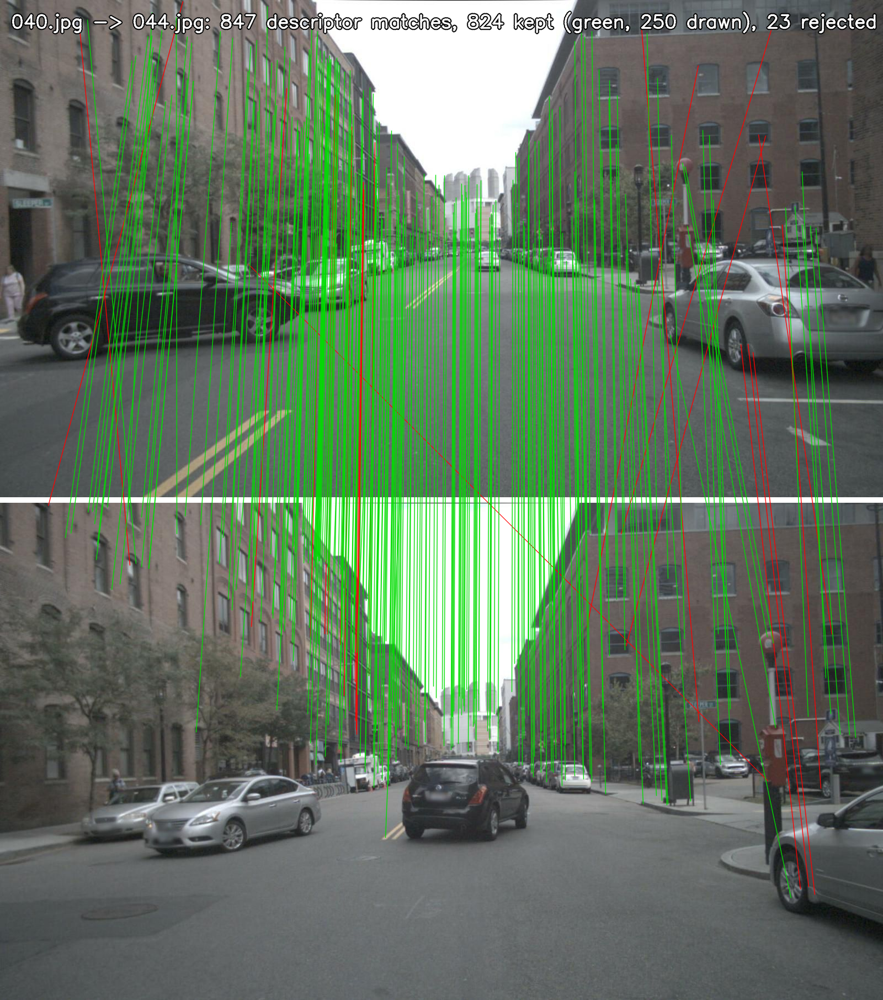
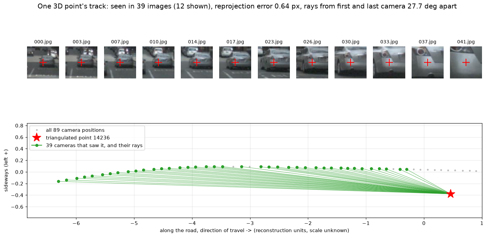
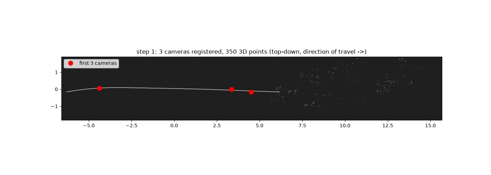

# Mini AV Stack

I'm building a small autonomous driving stack from the ground up: map a real place, localize in it, perceive what's around, plan, and drive in a simulated copy of it. Each part maps to a role on a real AV team. Coming from GIS, I'm going deepest on mapping and localization.

It runs on a laptop (RTX 5070 Ti, 12 GB VRAM) with CARLA as the simulator and ROS 2 as the middleware.



## Where it stands

| # | Phase | Status |
|---|-------|--------|
| 1 | Foundation: CARLA, ROS 2, pure pursuit and PID | Done |
| 2 | Mapping and reconstruction | In progress: 3D reconstruction works, lane map next |
| 3 | Localization (EKF, map matching) | Not started |
| 4 | Perception | Not started |
| 5 | Prediction and planning | Not started |
| 6 | Evaluation (20+ scenarios in CI) | Not started |

## Phase 1: Getting a car to drive itself

The goal was a complete loop, simulator to controller and back, before making any one part good. A Tesla Model 3 follows 600 m of lane centre in CARLA's Town01:

- **Steering: pure pursuit.** Each tick, the car picks a point on the path a few metres ahead (the red dot above) and steers along the arc that reaches it. The lookahead grows with speed, which trades tight tracking for smoothness.
- **Speed: PID**, with anti-windup so the integral doesn't build up while the throttle is maxed out.

It holds the lane to **0.08 m on average (1.01 m worst)** at 8 m/s. The same controller drove a map generated from OpenStreetMap (see Phase 2) with 0.07 m average error.

The controller also runs as a ROS 2 node. A small bridge I wrote publishes the car's pose (`/odom`) and path (`/path`) from CARLA and applies the controller's commands (`/cmd`). I wrote my own bridge rather than fight version compatibility between the official CARLA ROS bridge, ROS 2 Jazzy and CARLA 0.9.16. It's about 80 lines, and I know exactly what it does.

```bash
PYTHONPATH=control python sim/run_lap.py --camera chase --weather ClearSunset --realtime   # standalone
bash sim/launch_demo.sh                                                                    # ROS 2 controller + bridge
```

For now the car gets its exact position from the simulator and its path from CARLA's map. Later phases replace each of those shortcuts with a real module.

**What went wrong along the way**
- After 75 s the car swerved off the road. The path index wrapped from the end of the list back to the start, so it steered at a point hundreds of metres behind it. It now stops at the end of the path.
- The ROS bridge started, printed nothing, and did nothing. `main()` was defined but never called.
- A launch script overwrote `PYTHONPATH` instead of appending to it, which hid ROS's Python packages.
- A crashed client left CARLA stuck in synchronous mode, waiting for ticks that never came, so every later connection timed out.
- The car doesn't slow down for corners yet. Steering and speed are controlled separately, and speed planning is Phase 5's job.

## Phase 2: Mapping a real street

### OpenStreetMap to a drivable map

[`mapping/osm_to_carla.py`](mapping/osm_to_carla.py) downloads OSM roads for a bounding box, converts them to OpenDRIVE, and builds a CARLA world from them. A test area in Boston's Seaport came out as 537 roads and 101 junctions. OSM only has road centrelines, though, so every lane got a guessed 3.5 m width. That gap is why the rest of this phase exists.

### Reconstructing a street in 3D from camera images

[`mapping/nuscenes_sfm.py`](mapping/nuscenes_sfm.py) takes a nuScenes driving clip (scene-0103, about 118 m through Boston's Seaport district) and rebuilds the street with structure-from-motion in COLMAP:

```bash
python mapping/nuscenes_sfm.py scene-0103
```

It keeps the front-camera frames about 1 m apart, so the camera moves enough between images to triangulate. Then COLMAP runs in three stages, with the camera's calibrated intrinsics held fixed.

**1. Find distinctive points.** SIFT finds about 7,000 keypoints per image. They cluster on brick, windows and parked cars, and almost none land on the sky or the road surface. That matters when it's time to find lanes.



**2. Match them between images.** RANSAC keeps only the matches that agree with a single camera motion. Here the green lines fan out from the vanishing point, the signature of driving forward. The red ones are mostly windows matched to a different, identical-looking window.



**3. Build the 3D model.** COLMAP starts from one well-separated pair of images, then adds cameras one at a time, triangulating new points and re-optimising everything (bundle adjustment) as it goes. One point on a parked car was seen in 39 images. The more its viewing rays diverge, the more precisely its depth is known.





By the end, building façades line both sides of the street and parked cars sit along the kerbs. The road down the middle stays nearly empty.

**Results against nuScenes ground truth**

| | |
|---|---|
| Images placed | 89 of 89 |
| 3D points | ~23,700 |
| Reprojection error | 0.59 px |
| Camera position error | 8.6 cm horizontal, 22.8 cm vertical |
| Camera orientation error | 0.13° |
| Path length | 117.4 m (true: 117.5 m) |

### The 21° that almost got past me

A single camera can only rebuild a scene up to an unknown scale, rotation and offset. So to compare against ground truth, I first find the transform that best lines up the two sets of camera positions.

That alignment gave great position numbers but a **21° orientation error, the same for every camera**. The axis of the error ran right along the road. A nearly straight drive is basically a line, and a line can spin around its own axis without moving its points, so positions alone couldn't pin down the roll. COLMAP's cameras agreed with each other to 0.1°, so the problem was my alignment, not the reconstruction. Taking the rotation from the camera orientations instead fixed it: **21° → 0.13°**.

Fixing it exposed something else. Vertical error went up and follows a dip: +70 cm, then −27 cm, then +19 cm along the street. nuScenes poses are flat (z is always 0), so my guess is that the street really dips and the old alignment had tilted the model to flatten it. I haven't proven that yet. The test is to integrate the car's recorded pitch and see whether it predicts the same profile.

### Next: a lane-level map

I'm converting between nuScenes map coordinates and latitude/longitude ([`mapping/lane_map.py`](mapping/lane_map.py)) so OSM roads, nuScenes' surveyed lanes and this reconstruction can be overlaid in one frame. The question I want to answer is how far crowd-sourced maps sit from reality at lane level. After that I'll build a lane-level OpenDRIVE map of this street and drive it in CARLA.

## Setup

CARLA 0.9.16 runs natively on Windows. ROS 2 Jazzy, PyTorch (CUDA 12.8) and the reconstruction tools run in WSL2 Ubuntu 24.04. Full steps, including getting CUDA tooling working on a Blackwell GPU, are in [docs/phase1-setup.md](docs/phase1-setup.md) and [docs/phase2-setup.md](docs/phase2-setup.md).

Before trusting COLMAP and 3D Gaussian Splatting on real data, I ran both on a synthetic scene with known camera poses ([`mapping/gpu_check/`](mapping/gpu_check/)). COLMAP recovered the cameras to within 0.13 cm.

## Layout

```
control/      ROS 2 package: pure pursuit, PID, controller node
sim/          lap script, CARLA <-> ROS 2 bridge, launch script
mapping/      OSM -> OpenDRIVE, nuScenes SfM pipeline, visualizations, lane map (in progress)
docs/         setup notes and media
localization/ perception/ prediction/ planning/ scenarios/ docker/   (later phases)
```

## Data

Reconstruction images come from [nuScenes](https://www.nuscenes.org/) (CC BY-NC-SA 4.0). Road data © OpenStreetMap contributors (ODbL).
